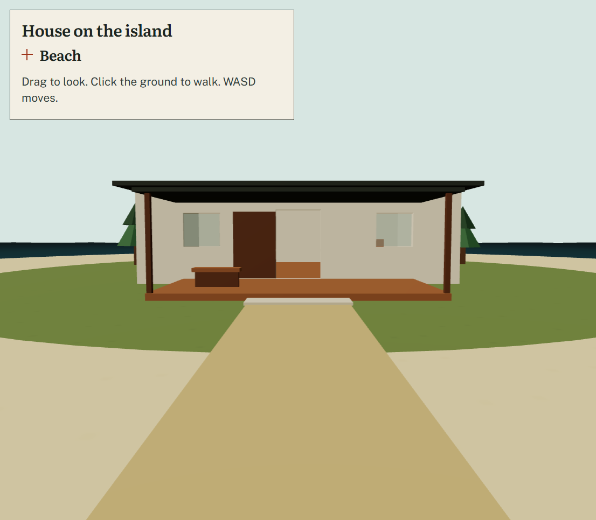

# House on the island

A static first-person walkthrough of a house on an island. Click or tap the ground to walk. Drag to look. On a computer with a mouse, WASD and the arrow keys also move. It is a Vite and Three.js site, so the build can sit on GitHub Pages.



## Run

```bash
npm install
npm run dev
```

`npm run build` writes the static site to `dist/`.

## Layout

`index.html` loads `src/main.js`, which starts the renderer.

| Path | Role |
| --- | --- |
| `src/content/site.js` | Page title, scene list, and the walk hint |
| `src/scenes/registry.js` | Scenes the app is allowed to build |
| `src/scenes/island-house/content.js` | Words, sizes, colors, furniture, and area notes |
| `src/scenes/island-house/create.js` | Builds the island from that file |
| `src/scenes/empty-stage/` | Blank scene. Copy this folder to add another |
| `src/engine/app.js` | Renderer, scene swap, and the frame loop |
| `src/engine/walk.js` | Look, click-to-walk, and desktop keys |
| `src/engine/build.js` | Walls, floors, and collision boxes |
| `src/ui/shell.js` | Title block, and the note shown inside an area |

Edit `island-house/content.js` to change the house. To add a scene, copy `empty-stage`, import it in `registry.js`, and add its id to `scenes` in `site.js`. Each scene `create()` returns the model, walkable floors, colliders, the spawn point, and `zoneAt`. An entry in `areas` shows its text when the player walks within `radius` meters of `position`.
